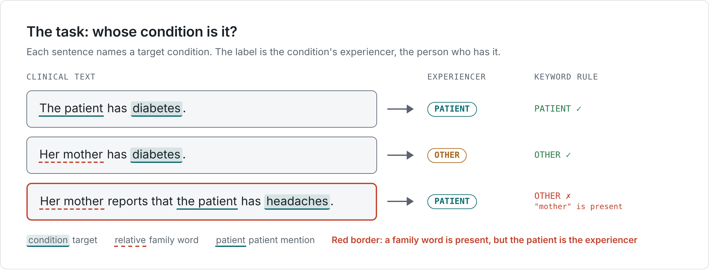
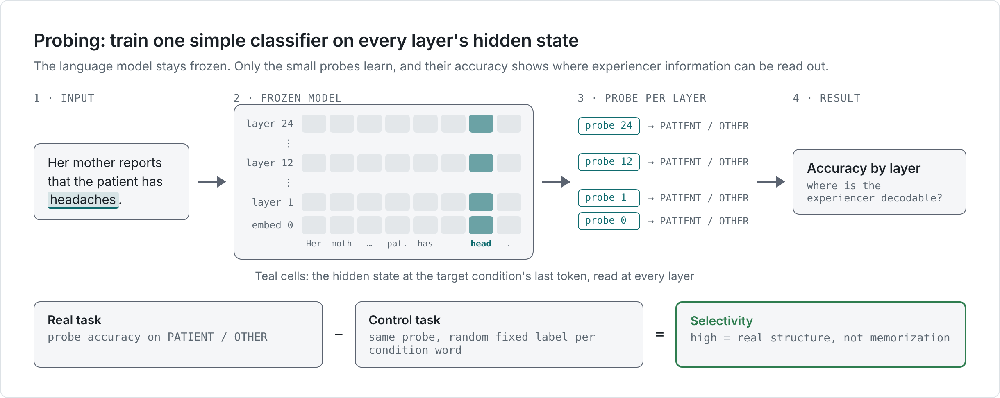
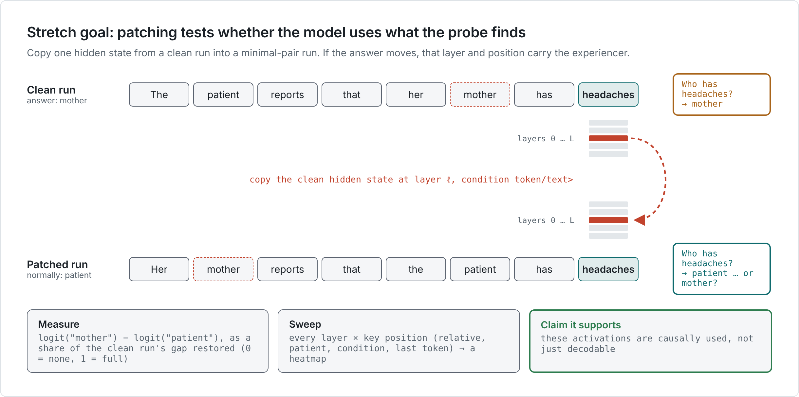
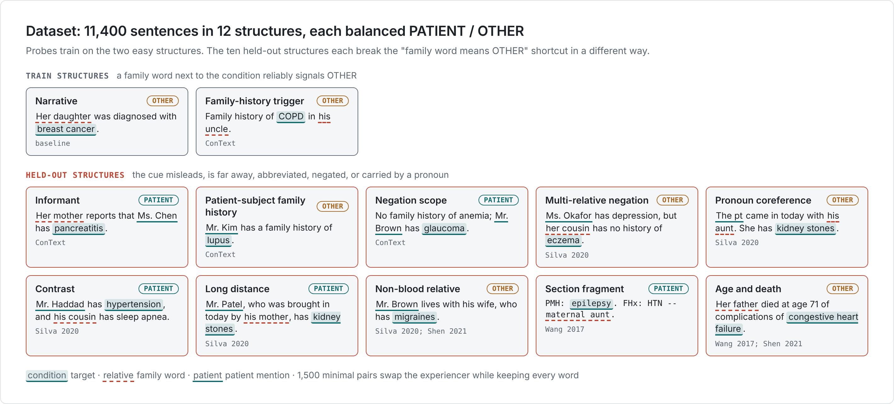
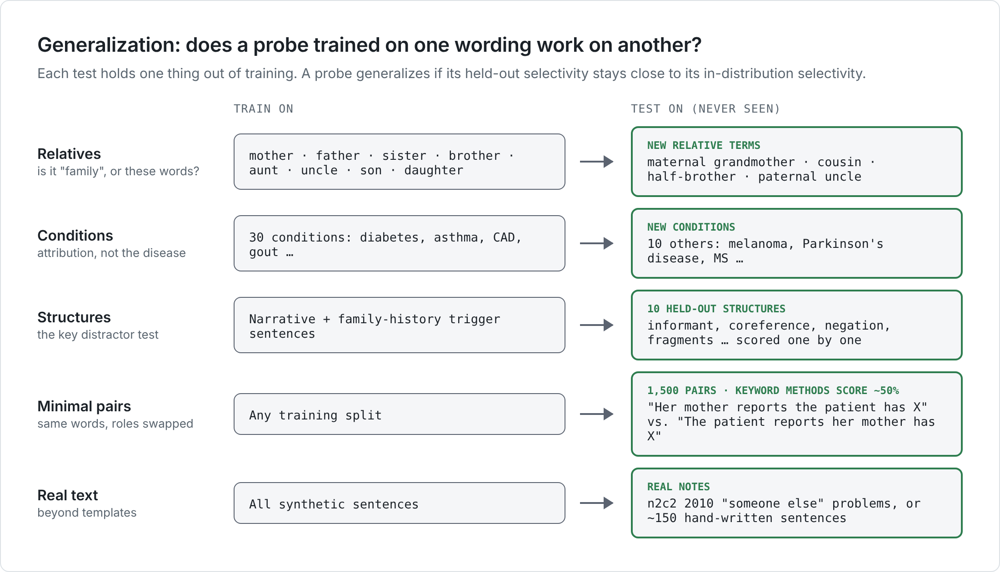
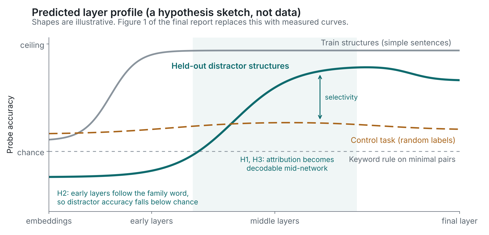
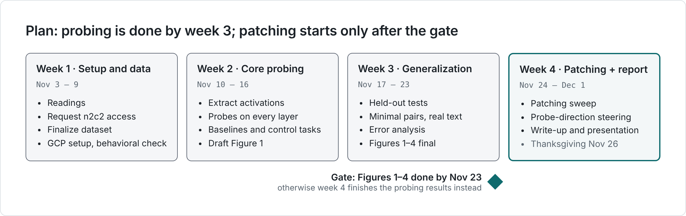

# Decoding Clinical Experiencer Information in a Small Language Model

**CPHC100 Final Project · Progress Report** · November 3, 2026

**Author:** Eva ([@zihaniseva](https://github.com/zihaniseva)) · **Partner:** none, working solo

📄 **[Read the illustrated report](https://zihaniseva.github.io/cph-100-final-project/)** (or open `index.html` in a browser)

## 1. Research question

**At which layers can we decode whether a disease belongs to the patient or a family member, and does that information generalize across wording?**

When a note mentions a disease, someone has to decide whose disease it is. This is called the condition's *experiencer*. A keyword rule handles the easy cases, but fails when a family member is mentioned without being the experiencer:

I will train simple linear classifiers (*probes*) on the hidden states of a small open-weights language model, one per layer, to find where the experiencer can be read out. Then I'll test whether those probes still work on sentence structures, relatives, and conditions they never saw. Probing is the required deliverable. Activation patching, which tests whether the model actually *uses* that information, is a stretch goal.

## 2. Why it matters

- **Misattribution has clinical consequences.** A mother's breast cancer belongs in the family history, where it may prompt screening. Put in the patient's own problem list, it is a wrong diagnosis. Cohort selection, problem-list extraction, and decision support all depend on getting experiencer right, which is why it is a standard part of clinical assertion detection.
- **Language models are being applied to clinical notes.** Recent work evaluates LLMs on assertion detection, including experiencer, by their *outputs*. Output accuracy doesn't show whether a model tracks who has what, or just reacts to words like "mother."
- **Keyword shortcuts are brittle.** Family history is mostly written as fragments, abbreviations, and lists (Wang et al., 2017), and the hardest sentences involve several relatives, negation, and pronouns (Silva et al., 2020). A model relying on keywords will fail on exactly these cases. Probing across controlled wordings shows whether the representation goes beyond the keyword.

**Contribution.** Prior work studies clinical experiencer classification (ConText; LLM assertion detection) and the layer-wise accessibility of linguistic information (Tenney et al., 2019). I investigate whether patient-versus-family attribution is linearly decodable across the layers of a small language model, and whether it generalizes beyond familiar lexical cues.

## 3. Proposed methods

### Probing (required)

1. **Behavioral check.** First, test whether the model can do the task: for each sentence, ask "Who has [condition]? Answer: The" and compare the probability of "patient" with the relative's noun. Report accuracy per sentence structure.
2. **Extract hidden states.** Save the residual stream after every layer, plus the embeddings, at the target condition's last token (primary), the sentence's final token, and the mean over the condition span.
3. **Train probes.** One L2-regularized logistic regression per layer and position. Regularization is tuned on validation data only. Results are averaged over 5 seeds with 95% confidence intervals.
4. **Control for memorization.** Following Hewitt & Liang (2019), train the same probe on a *control task*: a random but fixed label for each condition word. **Selectivity** = real-task accuracy minus control-task accuracy. It is the headline number, so a probe that just memorizes words can't look good.
5. **Choose the best layer** by validation selectivity. Its test score is reported once.

### Activation patching (stretch goal)

For minimal pairs the model answers correctly, I copy one hidden state from the clean run into the other run and measure how much of the clean answer comes back. Sweeping every layer and key position gives a heatmap of where the experiencer is causally used. If time allows, I'll also steer the model along the probe's learned direction. Patching starts only once the probing results are done (see the timeline).

## 4. Data and resources

### Synthetic dataset (primary, already built)

The generator in [`data/`](data/) produces **11,400 sentences** across **12 sentence structures**, labeled PATIENT or OTHER and balanced 50/50 within every structure. The structures come from how family history is actually written (Wang et al., 2017; Shen et al., 2021), from the patterns that break extraction systems (Silva et al., 2020), and from ConText's trigger and scope rules (Harkema et al., 2009). They include **1,500 minimal pairs**, which keep every word and swap the experiencer, so keyword methods score about 50% on them by construction. Column definitions and split usage are in the [data card](data/README.md).

### Real-text check (secondary)

- **i2b2/n2c2 2010 assertion corpus**: problems labeled "associated with someone else." It's free but requires a data use agreement, which I'm requesting this week.
- **Fallback:** about 150 hand-written, note-style sentences if access hasn't arrived by week 2. As I'm working alone, I'll label them twice, a week apart, and report self-agreement.
- Real notes are processed only on my own cloud VM, never sent to a hosted API.

### Model and compute

| Resource | Plan |
| --- | --- |
| Primary model | Qwen2.5-1.5B-Instruct (28 layers). Small enough to probe every layer, and able to answer "who has X?" for patching |
| Comparison model | Pythia-1.4B (24 layers), a base model common in interpretability work, for one replication of the layer curve |
| Compute | The course's $2,000 Google Cloud credit: an L4 GPU VM or Colab Enterprise. Expected use is well under $200, with a billing alert and idle shutdown |
| Software | Hugging Face Transformers (`output_hidden_states`), TransformerLens for patching, scikit-learn for probes |

## 5. Evaluation

**Generalization tests.** Each test holds one thing out of training. A probe *generalizes* if its held-out selectivity stays close to its in-distribution selectivity.

**Baselines.** Every probe result is compared against:

| Baseline | What it rules out |
| --- | --- |
| Majority class | Label imbalance |
| ConText-style keyword rule | That a trigger-word rule already solves it |
| Bag-of-words logistic regression | That word presence alone explains accuracy |
| Layer 0 (embeddings only) | That no contextual processing is needed |
| Randomly initialized model | That the architecture alone produces the signal |
| Shuffled labels | Leakage; should stay at chance |

**Hypotheses.** The sketch below shows what I expect. It isn't data, and the measured curves will replace it.

1. **H1, layer profile.** Experiencer is decodable above controls, with selectivity rising through early and middle layers and leveling off or dipping near the output.
2. **H2, cue reliance early.** Early-layer probes follow the family word, so they fail on distractor structures such as informant sentences ("Her mother reports that the patient has…").
3. **H3, generalization.** Middle-layer probes transfer better than early-layer probes to held-out relatives, conditions, and structures.
4. **H4, mechanism (stretch).** Patching minimal pairs shifts the model's answer at specific layers and positions.

**Planned figures.** (1) Accuracy, control accuracy, and selectivity by layer. (2) Accuracy by structure at early, middle, and late layers. (3) Generalization gap per test. (4) Minimal-pair accuracy by layer. (5) Patching heatmap, as a stretch goal. Plus an error analysis of 20–30 misclassified sentences at the best layer.

**What the results can support.** Probing shows information is *present* at a layer, not that the model uses it. I'll claim use only from patching or steering, and only for the sentence types tested. Results on templates aren't clinical validation; the real-text check shows how far they carry.

## 6. Timeline

## 7. Risks and open questions

### Risks

| Risk | Fallback |
| --- | --- |
| Working solo, so a month is tight | Probing (Figures 1–4) is the complete deliverable; patching runs only if the Nov 23 gate is met |
| The model fails the behavioral check on distractor structures | Probing still applies, since encoding can exist without behavior; patch only sentences it gets right |
| Probes score near 100% everywhere, even at layer 0 | Templates are too easy; add harder structures and weight minimal pairs more |
| Control task also scores high | Stronger regularization; rely on condition- and structure-based splits |
| n2c2 access doesn't arrive | Hand-written real-style sentences |
| Minimal pairs differ in token length | Keep only equal-length pairs for patching |

### Open questions for the teaching staff

1. Is a synthetic, template-based dataset acceptable as the **main** data, with real text only as a secondary check?
2. Is single-annotator labeling, with self-agreement a week apart, acceptable for the small real-text set, given I'm working solo?
3. Should spouses and partners count as OTHER? They are correct for experiencer, but they aren't family history in the hereditary sense. I currently label them OTHER and keep them in a separate structure.
4. Is an instruction-tuned model fine for probing, or would you prefer a base model as the primary model?

## References

- Belinkov, Y. (2022). Probing Classifiers: Promises, Shortcomings, and Advances. *Computational Linguistics*, 48(1).
- Feng, J., & Steinhardt, J. (2024). How Do Language Models Bind Entities in Context? *ICLR*.
- Harkema, H., Dowling, J. N., Thornblade, T., & Chapman, W. W. (2009). [ConText: An Algorithm for Determining Negation, Experiencer, and Temporal Status from Clinical Reports](https://pmc.ncbi.nlm.nih.gov/articles/PMC2757457). *Journal of Biomedical Informatics*, 42(5).
- Hewitt, J., & Liang, P. (2019). Designing and Interpreting Probes with Control Tasks. *EMNLP*.
- Shen, F., et al. (2021). [Family History Extraction From Synthetic Clinical Narratives Using NLP: n2c2/OHNLP 2019](https://medinform.jmir.org/2021/1/e24008/). *JMIR Medical Informatics*, 9(1).
- Silva, J. F., Almeida, J. R., & Matos, S. (2020). [Extraction of Family History Information From Clinical Notes: Deep Learning and Heuristics Approach](https://pmc.ncbi.nlm.nih.gov/articles/PMC7803476/). *JMIR Medical Informatics*, 8(12).
- Tenney, I., Das, D., & Pavlick, E. (2019). BERT Rediscovers the Classical NLP Pipeline. *ACL*.
- Wang, Y., et al. (2017). [Systematic Analysis of Free-Text Family History in Electronic Health Record](https://pmc.ncbi.nlm.nih.gov/articles/PMC5543380). *AMIA Joint Summits on Translational Science Proceedings*.
- Assertion Detection Large Language Model In-context Learning LoRA Fine-tuning (2024).
