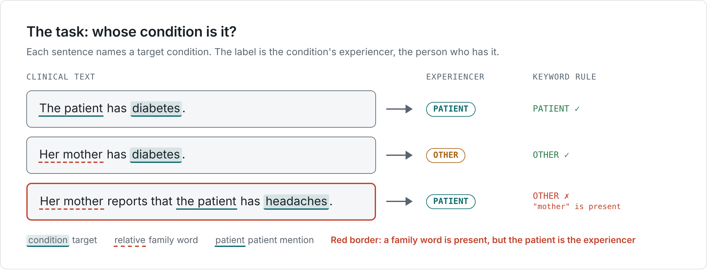
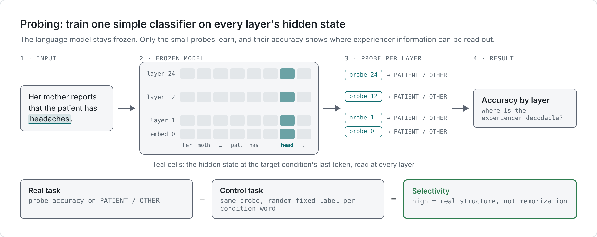
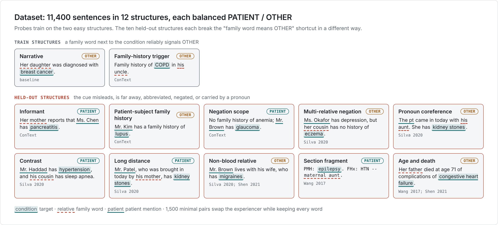

# Decoding Clinical Experiencer Information in a Small Language Model

**At which layers can we decode whether a disease belongs to the patient or a family member, and does that information generalize across wording?**

CPHC100 Final Project · Eva ([@zihaniseva](https://github.com/zihaniseva)), working solo · Fall 2026

📄 **[Read the illustrated report](https://zihaniseva.github.io/cph-100-final-project/)** (or open `index.html` in a browser) · **[Progress report source](PROPOSAL.md)**



## Approach

Train one linear probe per layer on a frozen model's hidden states at the condition token, and report **selectivity** (real-task accuracy minus a control task) so memorization can't pass for structure.



## Data

11,400 synthetic sentences in 12 structures drawn from how family history is actually written and from patterns that break extraction systems, with 1,500 minimal pairs. See the [data card](data/README.md).



## Repository

| Path | Contents |
| --- | --- |
| `PROPOSAL.md` | Progress report: question, motivation, methods, data, evaluation, risks, references |
| `index.html` | The same report as a styled page (built from `PROPOSAL.md`) |
| `data/` | Dataset generator, the generated CSV, and the data card |
| `figures/` | Report figures; `figures/src/` holds their sources |

## Rebuilding

```bash
python data/generate_dataset.py --out data/experiencer_dataset.csv   # dataset (standard library only)
python figures/src/build_report.py                                     # index.html from PROPOSAL.md (pip install markdown)
cd figures/src && node render.js "$PWD" .. task pipeline structures splits patching timeline   # diagram PNGs (Playwright)
python figures/src/predictions.py figures/predictions.png              # hypothesis sketch (matplotlib)
```
